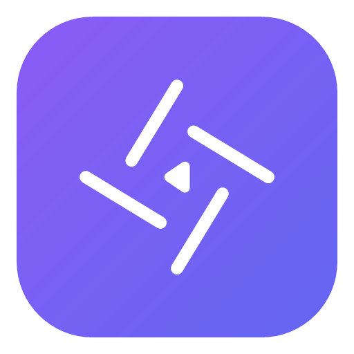

<div align="center">



# Rewind

**High-precision, zero-latency instant replay buffer engineered for competitive gaming and clean system setups.**

[](https://github.com/qavi999/Rewind)
[](https://github.com/qavi999/Rewind/releases)
[](https://github.com/qavi999/Rewind)
[](https://github.com/qavi999/Rewind)
[](LICENSE)
[](https://github.com/qavi999/Rewind/releases)

</div>

---

## ⚡ The Philosophy

Traditional game recording and clipping tools are bloated: heavy background overlays, mandatory accounts, background telemetry, and CPU utilization that degrades frametimes and introduces input lag during competitive play.

**Rewind is 100% free, open-source, and engineered strictly for maximum performance.**

It runs silently in your system tray, capturing the exact gameplay moments you want the millisecond you hit your hotkey without sacrificing a single frame.

---

## 📊 Ultra-Low Resource Architecture

- **⚡ Hardware-Accelerated Capture:**
  - **Windows:** DirectX Desktop Duplication API (DXGI) grabs frames directly from GPU VRAM. Zero cursor flicker, preserving full 240Hz / 280Hz / 360Hz monitor refresh rates.
  - **Linux:** KMS/X11/Wayland pipeline with low-latency desktop capture and hardware NVENC / VAAPI offloading.
- **🚀 < 0.5% CPU Overhead:** Offloads 100% of video encoding directly to dedicated GPU silicon (**NVIDIA NVENC**, **AMD AMF**, or **Intel QuickSync**), leaving your CPU completely free for gaming.
- **💾 Fixed ~80 MB RAM Ring Buffer:** Buffers gameplay entirely in high-speed system memory with a strictly bounded memory ceiling. Memory usage stays flat and never leaks over long gaming sessions.
- **🛡️ Zero SSD / Drive Thrashing:** Unlike tools that continuously write temporary video segments to your storage drive, Rewind only writes to disk when you explicitly press the clip hotkey, prolonging SSD lifespan and eliminating disk I/O micro-stutters.
- **⚡ Sub-100ms Instant Save:** Concatenates buffered video segments using instant stream-copy muxing (`-c copy`), delivering an MP4 file in milliseconds without re-encoding.
- **🚫 Zero Framework Bloat:** Pure native architecture. Zero Electron, zero Chromium wrappers, zero Node.js runtime, and zero background analytics or telemetry.

---

## ✨ Features (v0.2)

- **🐧 Complete Linux Support:**
  - Dedicated Linux client supporting **PipeWire**, **PulseAudio**, **X11**, and **Wayland** (GNOME, KDE, Sway).
  - Packaged with an easy installer (`install.sh`), system `.desktop` entry, CLI client (`rewind --save`, `rewind --save-long`), and full distribution tarball.
- **🎯 Secondary Hotkey (Long Clips):**
  - Configure a secondary hotkey (e.g., `F7`, `F11`, `Alt+F8`) with custom duration (e.g., 60s, 120s, 180s, 300s) to capture entire match rounds without changing your primary quick-clip shortcut.
- **⚙️ Advanced Settings Mode:**
  - Unlock custom text fields for arbitrary precision:
    - **Custom Volumes (0% – 1000%):** Amplify quiet microphones or game audio far beyond default limits.
    - **Custom Framerate:** 15 FPS up to 360 FPS.
    - **Custom Duration:** Any duration from 5s to 600s.
    - **Custom Bitrate:** Any value from 2 Mbps up to 150 Mbps.
    - **Custom Hotkey:** Any keyboard combination.
- **✂️ Lossless Quick Clip Trimmer:**
  - Trim clips right inside Rewind with instant sub-second export using stream copy without quality degradation.
- **💾 Smart Storage Manager:**
  - Enforce disk storage limits (e.g., max 25 GB, 50 GB) and auto-delete clips older than X days to prevent filling your disk.
- **🎧 Multi-track Audio Recording:**
  - Separate game sound and microphone into independent audio streams inside the MP4 container for seamless editing in Premiere, DaVinci Resolve, or Vegas Pro.
- **🎮 Non-Activating Gaming HUD Toast:**
  - Discreet, semi-transparent notification appears when a clip is saved with duration and direct folder access.
  - Engineered with native Windows `WS_EX_NOACTIVATE` — **never steals keyboard/mouse focus or minimizes fullscreen games**.
- **🔔 Procedural Sound Feedback:**
  - 4 lightweight procedural in-RAM sound presets (*Rewind, Shutter, Crystal Ding, 8-Bit Retro*).
  - Support for custom user `.wav` and `.mp3` audio files with instant live preview.
- **🖥️ Multi-Monitor Screen Selector:**
  - Choose which monitor to capture directly from settings with live display device detection.
- **🎨 Modern Dark & Light Interface:**
  - Distraction-free Raycast-inspired interface with seamless Dark and Light themes.
  - Double-click clips to open instantly; press `Delete` to remove clips.
- **🌐 All-In-One Multi-Language Setup:**
  - Standalone installer (`RewindSetup.exe`) and application with 6 languages (*English, Polski, Deutsch, Español, Français, Українська*).

---

## ⌨️ Hotkeys & Configuration

| Setting | Default | Standard Options | Advanced Mode (Any Custom Value) |
|---|---|---|---|
| **Primary Hotkey** | `F8` | `F7`, `F8`, `F9`, `F10`, `Alt+C` | Any key combination (e.g. `Ctrl+Shift+S`) |
| **Secondary Hotkey** | `F7` (120s) | `F7`, `F11`, `F12`, `Alt+F8` | Any key combination |
| **Buffer Duration** | `30s` | `15s`, `30s`, `60s`, `120s` | `5s` – `600s` |
| **Framerate** | `60 FPS` | `30 FPS`, `60 FPS` | `15 FPS` – `360 FPS` |
| **Video Bitrate** | `12 Mbps` | `8 Mbps`, `12 Mbps`, `16 Mbps` | `2 Mbps` – `150 Mbps` |
| **Audio Volume** | `100%` | `0%` – `150%` sliders | `0%` – `1000%` arbitrary amplification |
| **Display Selector** | Primary | Any connected display / monitor | Multi-monitor selection |
| **Capture Cursor** | Disabled | Enabled / Disabled | Toggleable |
| **Multi-Track Audio** | Disabled | Enabled / Disabled | Independent tracks in MP4 |
| **Storage Limit** | Disabled | 10 GB, 25 GB, 50 GB, 100 GB | Auto-prunes oldest replays |

---

## 🚀 Download & Installation

### Windows:
1. Download **`RewindSetup.exe`** (Installer) or **`Rewind.exe`** (Standalone Portable) from [Releases](https://github.com/qavi999/Rewind/releases).
2. Choose your language, select installation options, and click **Install**.
3. Press `F8` (or your configured hotkey) in any game or desktop to capture your clip instantly.

### Linux:
1. Download **`Rewind-v0.2-Linux.tar.gz`** from [Releases](https://github.com/qavi999/Rewind/releases).
2. Extract the archive and run the installer:
   ```bash
   tar -xzf Rewind-v0.2-Linux.tar.gz
   cd Rewind-v0.2-Linux
   ./install.sh
   ```
3. Launch `rewind` from your application menu or terminal.
4. On Wayland, bind your preferred key (e.g. `F8`) in your system keyboard shortcuts to `rewind --save`.

---

## 📄 License

Rewind is free and open-source software licensed under the [MIT License](LICENSE).
